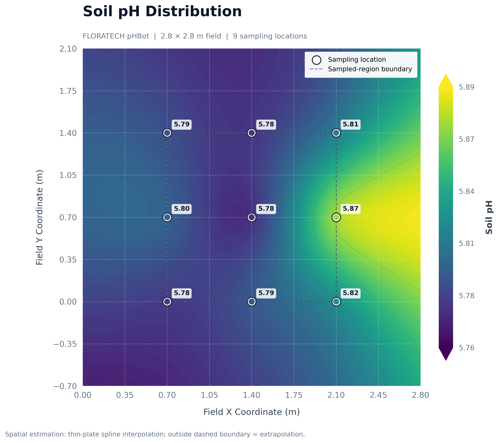

# FloraTech `phbot_ph` (ROS 2 Soil pH Simulation & Telemetry Package)

ROS 2 Python package (`phbot_ph`) developed for the **FloraTech** soil-sampling robot project, providing synthetic soil pH modeling, EKF sampling pose validation, a cancellable `/ph/sample` ROS 2 action server, per-mission CSV telemetry logging, and unit tests.

## Simulation Visuals & Outputs

### FloraTech pHBot Soil pH Distribution Heatmap

**What this shows:** A `2.8 x 2.8 m` field (`X` from `0.00` to `2.80 m`, `Y` from `-0.70` to `2.10 m`) across `9` sampling locations (measured values shown between `5.78` and `5.87` pH) with a dashed sampled-region boundary and thin-plate spline spatial estimation (extrapolating outside the dashed boundary).

## Package Structure & Core Modules
* **`/phbot_ph/phbot_ph/ph_simulation_core.py`:** ROS-independent `SoilPhModel` and `PhReading` classes modeling a `6m x 6m` synthetic pH anchor field (`CloughTocher2DInterpolator` with `NearestNDInterpolator` fallback), temperature-dependent Nernst potential (`19.0–23.5 °C`), Gaussian electrode noise, and virtual ADC quantization.
* **`/phbot_ph/phbot_ph/sampling_pose_core.py`:** Pure pose-validation module (`SamplingPose`, `capture_sampling_pose`) checking odometry availability, frame ID (`odom`), receipt freshness, header timestamp age, field bounds, and target offset tolerance before snapping a sample pose.
* **`/phbot_ph/phbot_ph/mission_csv_core.py`:** ROS-independent `MissionCsvRecorder` and `output_path_for_mission` utilities for deterministic per-mission CSV logging (`<stem>_<mission-id>.csv` or `standalone_<uuid>`), path/ID validation, and CSV header schema verification.
* **`/phbot_ph/phbot_ph/ph_simulation_node.py`:** Multi-threaded `rclpy` node (`PHSimulationNode`) running the cancellable `/ph/sample` action server (`SamplePh`), subscribing to `/localization/odom`, publishing `/ph/measurement` (`PhMeasurement`), and writing mission CSV logs.
* **`/phbot_ph/phbot_ph/ph_map_node.py`:** `rclpy` node (`PHMapNode`) initialized for mapping integration.
* **`/phbot_ph/test/`:** Unit and lint tests including `test_mission_csv_core.py`, `test_ph_simulation_core.py`, `test_sampling_pose_core.py`, `test_copyright.py`, `test_flake8.py`, and `test_pep257.py`.

## ROS 2 Interfaces
* **Action Server:** `/ph/sample` (`phbot_interfaces/action/SamplePh`) — validates goals, snapshots EKF pose prior to dwell, supports cancellation, and returns completed measurements.
* **Subscribed Topic:** `/localization/odom` (`nav_msgs/msg/Odometry`) — supplies robot pose and timestamps for freshness and tolerance checks.
* **Published Topic:** `/ph/measurement` (`phbot_interfaces/msg/PhMeasurement`) — publishes completed pH and temperature readings.

## How to Build & Run (ROS 2)
1. Place `phbot_ph` inside your ROS 2 workspace `src/` directory alongside `phbot_interfaces`.
2. Build with `colcon build --packages-select phbot_ph` and source your workspace (`source install/setup.bash`).
3. Run the simulation node via `ros2 run phbot_ph ph_simulation_node` (or run unit tests with `pytest` / `colcon test --packages-select phbot_ph`).
